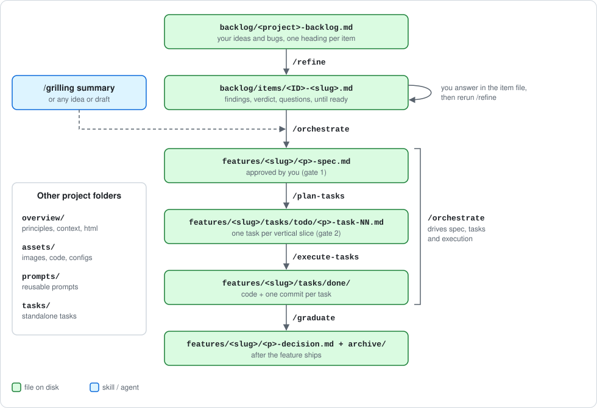
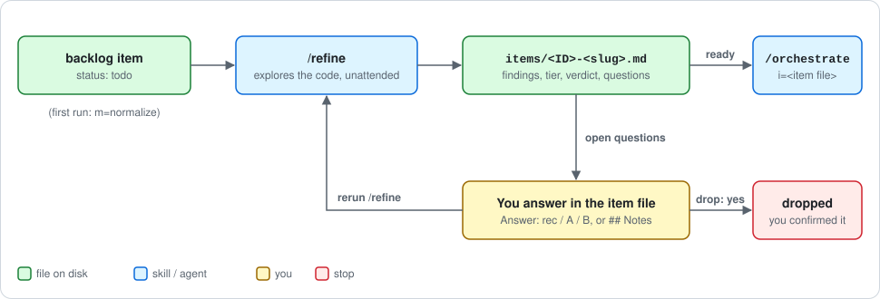
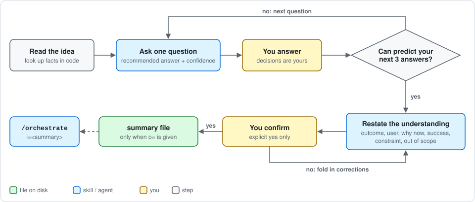
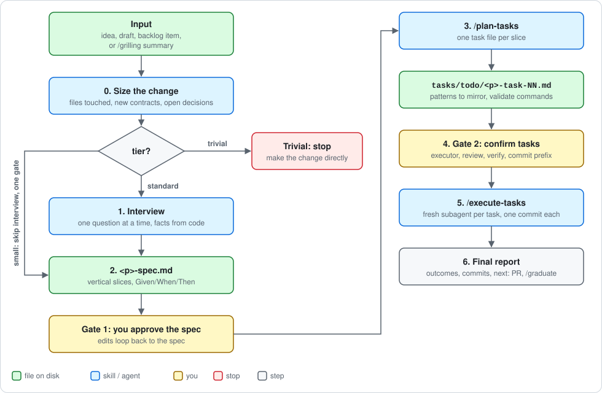
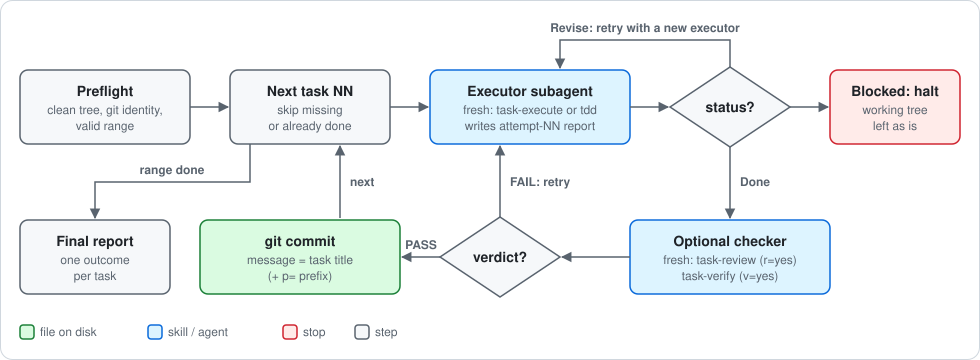

# spec-forge

Skill pack for **Claude Code** and **OpenCode** implementing a staged, file-driven planning workflow: from a backlog item to committed code, with every step's state kept on disk.

Installation, compatibility and Windows notes: see [INSTALL.md](INSTALL.md).

## Project layout

The skills work on a per-project folder, recommended structure:

```
<project>/
  assets/      files the agents use: images, code, configs
  backlog/     the backlog, input of /refine
    <project>-backlog.md
    items/     one file per refined item, written by /refine
  overview/    context files for the agents, html overviews for humans
    principles.md   written by /project-principles, read as binding rules
  features/    output of /orchestrate, one folder per feature
    <slug>/
      <p>-spec.md
      tasks/todo/  tasks/done/  tasks/feedback/
  prompts/     generic prompts, reused more than once
  tasks/       standalone tasks, not part of a feature
    todo/  done/
```

## The workflow



1. [`/refine`](#1-refine-the-backlog) explores backlog items while you are away and asks its questions in a file.
2. [`/grilling`](#2-stress-test-an-idea) (optional) stress-tests an idea that is not in the backlog.
3. [`/orchestrate`](#3-build-a-feature) turns a ready item or idea into a spec, task files and one commit per task.
4. [`/graduate`](#4-after-the-feature) retires the feature folder once it ships.

Every step is also a skill you can run by hand.

## 1. Refine the backlog

`/refine` does the expensive part of a backlog item, the exploration, without you watching. For each item it reads the code, sizes the change, judges if it is worth doing, and writes the decisions it cannot make as questions in the item file. You answer there when you have time; the next run folds the answers in, until the item is ready for `/orchestrate`.



**Backlog format.** One file, three sections (`Bugs`, `Minor`, `Major`), one heading per item. The backlog holds only your text; refine writes to `items/<ID>-<slug>.md` and links it with the `Item:` line.

```markdown
# MoDb Backlog

Prefix: MODB
Legend: 📋 todo | ❓ waiting answers | 🟢 ready | 🚧 in progress | ✅ done | ❌ dropped

## Bugs
### 📋 MODB-6 Search crashes on empty query
Typing a space and pressing search closes the app.

## Major
### ❓ MODB-3 Search for vidsrc alternatives
Item: [items/MODB-3-vidsrc-alternatives.md](items/MODB-3-vidsrc-alternatives.md)

Implement more than one source, so playback survives when vidsrc is down.
```

**Item file.** Findings (with `file:line`), tier, verdict, and up to 5 questions per round, each with options and one recommended. Answer with `Answer: rec` (take the recommendation), a letter, or free text; or write context in `## Notes`. Answered questions move to `## Decisions`. When nothing is open, refine writes `## Understanding` and marks the item 🟢.

```
/refine i=MoDb/backlog/modb-backlog.md m=normalize            # once: convert a backlog to the format above
/refine i=MoDb/backlog/modb-backlog.md                        # all eligible items, up to 3 in parallel
/refine i=MoDb/backlog/modb-backlog.md id=MODB-3 c=~/src/mine/modb
```

Read-only on the codebase. It changes only item files and, in the backlog, status emojis and `Item:` lines.

## 2. Stress-test an idea

`/grilling` is a live interview: one question at a time, each with a recommended answer and a confidence number. Facts come from the code; decisions are yours. It stops when it can predict your next three answers, restates the understanding (outcome, user, why now, success, constraint, out of scope) and waits for an explicit yes.



Nothing is written unless you pass `o=`. A saved summary is a valid `/orchestrate` input, which then asks only about the gaps.

```
/grilling i=inbox/idea.md o=features/auth/auth-understanding.md
```

`/refine` is the asynchronous version of the same interview, for backlog items.

## 3. Build a feature

`/orchestrate` takes an idea to committed code with two human gates: approve the spec, then confirm the task list and run options.



```
/orchestrate i=MoDb/backlog/items/MODB-3-vidsrc-alternatives.md o=MoDb/features/vidsrc/ p=vidsrc
/orchestrate i=features/auth/auth-understanding.md o=features/auth/ p=auth c=/path/to/repo
```

- **Input** (`i=`): a ready backlog item, a `/grilling` summary, a draft, or the idea in chat.
- **Size first.** Trivial changes are sent back to be made directly. Small ones skip the interview and get one gate. Changes touching security or a public API are always standard. You can override the tier.
- **Spec** (`<p>-spec.md`): problem, goals, non-goals, decisions, codebase patterns and test commands, vertical slices with Given/When/Then.
- **Tasks** (`/plan-tasks`): one file per slice in `tasks/todo/`, each carrying the patterns to mirror and commands to validate, so a fresh executor does not search for them.
- **Gate 2** asks for executor (`task-execute` or `tdd`), review, verify and commit prefix; `go` takes the defaults. It also checks the working tree is clean and offers to commit the spec and tasks.
- **Plan only:** stop at gate 2. Run `/execute-tasks` later.
- **Resume:** state is on disk, so a new run picks up at the first step whose output is missing.
- **Brownfield:** `c=` points at a repo other than the current directory.

`overview/principles.md`, when present, is binding for `orchestrate` and the executors.

### Execution: /execute-tasks

Runs a contiguous range of task files unattended. It writes no code itself: each task goes to a fresh executor subagent, optional gates run in a separate checker subagent (no agent grades its own work), and each passing task gets one local commit.



```
/execute-tasks i=features/auth/tasks/todo/auth-task-01.md to=5 p=[auth]
/execute-tasks i=features/auth/tasks/todo/auth-task-01.md to=5 e=tdd r=yes v=yes c=/path/to/repo
```

| Arg | Meaning |
|-----|---------|
| `i` | first task file of the range, in `tasks/todo/` |
| `to` | last task number, inclusive (a number, not a count) |
| `e` | `e=tdd` uses `tdd` as executor (default `task-execute`) |
| `r` / `v` | `yes` runs `task-review` / `task-verify` after each task (default off) |
| `c` | codebase root, forwarded to `task-review` |
| `p` | commit prefix, prepended verbatim plus one space |

- **Commits:** message is the task title (`# [auth-task-03] Add token expiry check` gives `[auth] Add token expiry check` with `p=[auth]`). No push, no branch, no PR.
- **Preflight** refuses a dirty tree (each commit runs `git add -A`), unset git identity, or an inverted range.
- **Halt** on the first blocked task, leaving the working tree as is. Rerunning the same range skips done tasks.

**Task state lives in files.** Each task has `Status:` (`Draft | Approved | Revise | Done | Blocked`), `Attempts:` and `Max attempts:`; the folder (`todo/` or `done/`) also signals state. The executor, `task-review` and `task-verify` each write a report per attempt to `tasks/feedback/` (`<task-id>-attempt-NN.md`, `-review-NN.md`, `-verify-NN.md`) with a `verdict` and `failed_checks`. A retry fixes only the `failed_checks` of the latest failing report.

### Running steps by hand

Every stage of `/orchestrate` is its own skill:

```
/plan-tasks  i=features/auth/auth-spec.md o=features/auth/tasks/todo/ p=auth
/task-execute i=features/auth/tasks/todo/auth-task-01.md     # implement, verify, move to done/
/tdd          i=features/auth/tasks/todo/auth-task-01.md     # same, test-first
/task-review  i=features/auth/tasks/done/auth-task-01.md     # read-only review report
/task-verify  i=features/auth/tasks/done/auth-task-01.md     # read-only Given/When/Then check
```

`/task-execute` and `/tdd` also work on standalone tasks in the project's `tasks/` folder.

## 4. After the feature

- **Pull request:** ask the agent to open it. The `pr` skill loads automatically and shapes the body (Summary visual, before/after Evidence from `tasks/feedback/`, Merge Danger). It does not push or create branches.
- **Retire:** once merged and stable, `/graduate o=features/auth/ p=auth` writes a one-page `auth-decision.md`, keeps your original draft, and moves the rest to `archive/`.
- **Session end:** `/handoff o=sessions/2026-05-23-auth.md n="Begin auth-task-02"` writes a resumable session document.

## Other skills

| Skill | What it does |
|-------|--------------|
| `/project-principles o=overview/principles.md` | Short, durable project rules that `orchestrate` and the executors treat as binding |
| `/conversation o=overview/conversations/<topic>` | Read-only Q&A about the codebase; on "save" writes `<o>.md` + `<o>-qa.md`, "save html" adds `<o>.html` |
| `/improve-codebase-architecture` | Finds shallow modules, scattered concepts and tight coupling; writes `architecture-report.md` |
| `/detail-level d=<01-05>` | Caps how much the agent writes per chat turn; `more detail` expands one answer, `d=5` is off |
| `/teach` | Stateful learning workspace (lessons, learning records, references) over many sessions |
| `/coding-principles`, `/<lang>-coding-standards` | Code guidelines: generic, Java, Go, Rust, Swift, TypeScript, Python, Kotlin |
| `sf-scheduler` | Unattended tasks while you are away: drop a task file in a watched folder. See [sf-scheduler/README.md](sf-scheduler/README.md) |

## Reference

### Skills

| Skill | Input | Output |
|-------|-------|--------|
| `refine` | backlog file (+ item IDs) | `backlog/items/<ID>-<slug>.md`, backlog statuses |
| `grilling` | idea, plan or decision | confirmed understanding (file only with `o=`) |
| `orchestrate` | idea, draft, item or summary | spec, tasks, committed code |
| `plan-tasks` | approved spec | `tasks/todo/<p>-task-NN.md` |
| `execute-tasks` | first task file + last task number | executed range, one commit per task |
| `task-execute` | one task file | code, task moved to `tasks/done/` |
| `tdd` | one task file | code + tests, task moved to `tasks/done/` |
| `task-review` | one task file | review report (read-only) |
| `task-verify` | one task file | pass/fail report (read-only) |
| `pr` | branch commits (+ `tasks/feedback/`) | PR body (model-invoked) |
| `graduate` | shipped feature dir + prefix | `<p>-decision.md` + `archive/` |
| `handoff` | session state | `sessions/<name>.md` |
| `project-principles` | project rules | `overview/principles.md` |
| `conversation` | optional existing conversation | `<o>.md` + `<o>-qa.md` (+ `<o>.html`) |
| `improve-codebase-architecture` | current directory | `architecture-report.md` |
| `detail-level` | level `01`-`05` | shorter chat answers, no files |
| `teach` | topic | teaching workspace |
| `sf-scheduler-run` | sf-scheduler task file + results dir | `report.md` or `summary.md` (launcher-invoked) |
| `angular-clean-code` | Angular code | review findings + safe refactors |
| `react-clean-code` | React code | review findings + safe refactors |
| coding standards | code | guidelines |

### Arguments

| Arg | Stands for | Used by |
|-----|-----------|---------|
| `i` | input file | refine, grilling, orchestrate, plan-tasks, task-execute, tdd, task-review, task-verify, execute-tasks, conversation |
| `o` | output file or directory | all writing skills |
| `c` | codebase root (brownfield) | refine, orchestrate, tdd, task-review, execute-tasks |
| `p` | prefix (filenames, task IDs) or commit prefix | orchestrate, plan-tasks, graduate, execute-tasks |
| `e` | executor (`e=tdd`) | execute-tasks |
| `to` | last task number, inclusive | execute-tasks |
| `r` / `v` | run task-review / task-verify (`yes`) | execute-tasks |
| `d` | detail level `01`-`05` | detail-level, conversation |
| `n` | next-session purpose | handoff |
| `id` | backlog item IDs or `all` | refine |
| `m` | mode (`normalize`) | refine |
