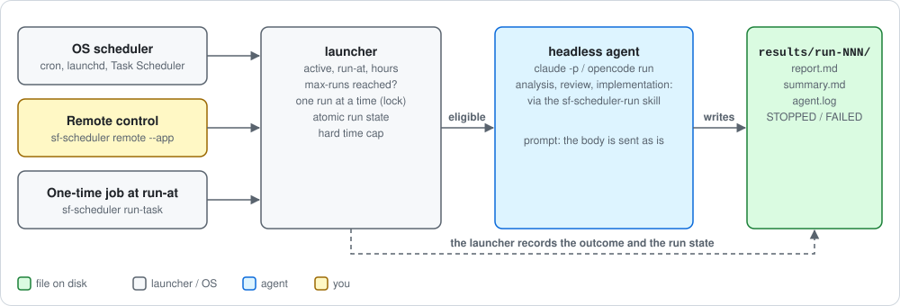
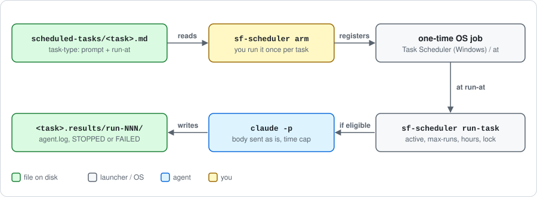

# sf-scheduler

Run simple, well-scoped AI tasks against a codebase while you are away from the
computer. Drop a task file in a watched folder (or schedule it), and a headless
AI agent picks it up, does the work, and leaves the result behind for you to
review later.

## How it works

sf-scheduler is a **thin launcher plus a skill**, not a standalone app.

- The **launcher** (`src/sf_scheduler/`, Python) does only the parts that must be
  deterministic: decide which task files are due (`active` / `hours` /
  `max-runs`), keep an atomic per-task run-count state, never run a task twice
  at once, and enforce a hard time cap that kills a runaway run.
- The **`sf-scheduler-run` skill** (`skills/sf-scheduler-run/` in this repo) tells
  the headless agent what to actually do per task type.
  A `prompt` task skips the skill: its body is sent to the agent as is.
- **cron / launchd / Task Scheduler** fires the launcher on a schedule, a
  one-time job fires one task at its `run-at`, and **Claude Code / Antigravity remote control**
  triggers it on demand.



## Folders

Each app under `~/ai-specs` has two intake folders the launcher scans:

- `remote-tasks/` - tasks picked up on demand (remote trigger).
- `scheduled-tasks/` - tasks picked up by time (scheduled trigger).

## Task types

- `analysis` - report on part of the code.
- `review` - task-review report of findings to implement later.
- `implementation` - carry out an instruction, on a dedicated git branch only (never `main`).
- `prompt` - the body is sent as-is to the agent: a slash command, a skill call or free text. Pair with `run-at` to run it at an exact time (`sf-scheduler arm`, see [`docs/scheduling.md`](docs/scheduling.md)).

## Run a task at an exact time



1. Create a task file in `<root>/<app>/scheduled-tasks/` with `run-at: "YYYY-MM-DD HH:MM"`.
2. Register it with the OS, once per task:

   ```
   sf-scheduler arm --root <root>
   ```

   (or `python -m sf_scheduler.cli arm --root <root>` if the command is not on PATH).

Step 2 is required: without it nothing is scheduled. Nothing else needs to be
activated. Details, how to check the job and requirements:
[`docs/scheduling.md`](docs/scheduling.md).

On Windows, list the armed jobs. `NextRunTime` is the task's `run-at`:

```powershell
Get-ScheduledTask -TaskName 'sf-scheduler-*' | Get-ScheduledTaskInfo | Format-List TaskName,NextRunTime
```

The job is deleted after the run is attempted. To remove one by hand (for example
a job left from before that, or a task you no longer want to run), use the
`TaskName` from the list:

```powershell
Unregister-ScheduledTask -TaskName 'sf-scheduler-<task>-<hash>' -Confirm:$false
```

On Linux and macOS the job is an `at` job. List the pending jobs with `atq` (it
shows the job id and the run time, not the task name) and remove one by id. A job
that already ran is gone, so there is nothing to clean up:

```sh
atq
atrm <job-id>
```

On macOS `atd` is disabled by default, so enable it before using `arm`.

## Where to start

- Task-file format and folder/state/marker layout: [`docs/task-file-schema.md`](docs/task-file-schema.md).
- Example tasks: [`examples/`](examples/).

## Remote session setup

To trigger tasks from a phone via Claude Code or Antigravity remote control without typing long
commands, add this to `~/.claude/CLAUDE.md` / `~/.gemini/config/AGENTS.md` (already included by `install-rules`):

```markdown
## Remote Sessions
When asked about remote tasks or to run them, check `~/src/mine/ai-mine-specs/apps/`.
Each app subfolder may have a `remote-tasks/` directory with `.md` task files.
To run tasks for an app: `sf-scheduler remote --root ~/src/mine/ai-mine-specs/apps --app <app-name>`
```

Then from the remote session just say: "run remote tasks for `<app>`" and Claude
runs the command. No manual typing of the full path required.

## Planned enhancements

- **Per-task model selection** - add a `model` frontmatter field (e.g. `model: claude-opus-4-8`) and pass `--model` to the headless agent command. Currently the default Claude Code model is used for all runs.

## Safety

- A hard time cap (`--timeout`, default 30 minutes) kills a runaway run and
  every process it started.
- `max-budget-usd` is a hard spend cap for `claude` tasks, enforced by the
  `claude` CLI. `max-tokens` is only a budget the agent is told about: nothing
  measures it.
- A task never runs twice at once. Each run holds a lock, so overlapping
  launcher fires are safe, and a run whose launcher died is closed as `FAILED`
  on the next scan.
- `implementation` tasks never touch `main`; work lands on a dedicated branch.
- Every run leaves a result, a `STOPPED` marker, or a `FAILED` marker on disk
  (there are no notifications in v1).
